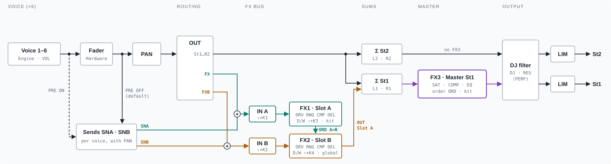

# OE02-Samples+

A fork of [OpenElixir-02](https://github.com/tunefish777/openelixir-02) for the Erica Synths
LXR-02 that adds user samples and single-cycle waves from the SD card (as oscillator and LFO
waveforms, with start, length and loops), a second FX slot and a master bus (saturation,
compressor, EQ), per-track step grids, ratchets and trigger tracks, new LFO shapes and kit/voice
morphing.

> Not official Erica Synths firmware, not affiliated with or approved by Erica Synths. You install it
> at your own risk.

## Who made what

| Part | Author |
|---|---|
| LXR V2 firmware, bootloader, build system | [Erica Synths](https://github.com/erica-synths/lxr-desktop-app) (open-sourced 2026), originally based on the Sonic Potions LXR |
| OpenElixir-02: voice engines, kit management, uninterrupted audio, limiter, DJ filter, bug fixes | Moritz Waser ([tunefish777/openelixir-02](https://github.com/tunefish777/openelixir-02)) |
| Sample extension (this fork, `MOD` commits after OpenElixir-02 v1.2) | shellbeat-jpg, written with Claude (Anthropic) |

Everything that isn't listed under "What this fork adds" below is OpenElixir-02 v1.2 as released by its
author: its features are listed in the next section, its full README is
[README_OPENELIXIR.md](README_OPENELIXIR.md), more details are in [docs/](docs/). The changes of this
fork can be listed with `git log v1.2..HEAD`.

## Overview

All features compared with the Erica Synths firmware, OpenElixir-02 included. **[OE]** = from
OpenElixir-02 v1.2, everything else from this fork. 
"Global" = saved with SAVE → Global and in the project file. NRPN n = parameter 128 + n.
Also as a file: [docs/OVERVIEW.md](docs/OVERVIEW.md), in German: [docs/OVERVIEW.de.md](docs/OVERVIEW.de.md).
As a supplement to the LXR owners manual (PDF, its layout and parameter tables):
[docs/OE02-Samples_Manual_Supplement.pdf](docs/OE02-Samples_Manual_Supplement.pdf).

### Voices

| Feature | Description | UI | Stored in | MIDI |
|---|---|---|---|---|
| Engines [OE] | Any engine freely assignable to each voice | VOICE (SHIFT + KIT) | Kit | NRPN 98 |
| Samples | Up to 31 WAVs, 5.9 s in total (with `BIGFLASH` ≈ 17.8 s). Start and length parameters in ms with fades, loops with crossfade, declick on retrigger. | VOICE (OSC `WAV`, `STA`, `LEN`) | Kit, samples in flash | CC 2–5, 7, 8 (`WAV` / Voice 1–6), NRPN 100–105 (`STA` / Voice 1–6), NRPN 93, 94, 97 (`LEN` / Voice 1–3) |
| User waves | Up to 8 WAVs from `SAMPLES/WAVES` as single cycles (1024 points): oscillator waveforms `W1`…`W8` (fixed values after `S1`…`S31`) and LFO shapes `W1`…`W8` (running) / `W1.`…`W8.` (one-shot); numbered on their own. | VOICE (OSC `WAV`, LFO `WAV`) | Kit (number), waves in flash | CC 2–5, 7, 8 (`WAV` / Voice 1–6), NRPN 27–32 (LFO `WAV` / Voice 1–6) |
| Choke | Voices of the choke group cut each other (≈ 2 ms). | VOICE (AEG `CHK`) | Kit | NRPN 99 |
| Track 7 | Own waveform/sample, pitch, sends and pan for track 7 on the shared voice of slot 6, e.g. closed/open hi-hat samples, only one of them into the reverb. | VOICE 7 (OSC `WAV`, `COA`; AEG `SNA`, `SNB`; MIX `PAN`) | Kit | – |

### Sequencer / tracks

| Feature | Description | UI | Stored in | MIDI |
|---|---|---|---|---|
| Lock trigger | Lock trigger for automation with velocity 0 | STEP (`VEL`) | Pattern | – |
| Pattern mode | Patterns switch at once on the next step | CONFIG (`IPS`) | Global | – |
| Grid per track | `1/4` … `1/32T` incl. `1/16.`, `5/64`, `1/32.`: 1/16 tracks keep their timing. Roll `ROL` counts in the track's own steps. | LAST STEP (encoder click), PERF (`ROL`) | Pattern | – |
| Ratchets and roll locks | Flam `X12`, `X24`, `X4+`/`X4-` (velocity slope); `1/8` … `1/1` repeats the step every 2–16 steps until the next active step. | STEP (`FLM`) | Pattern | – |
| Trigger tracks | Each active step (any velocity) acts on a target track: `RST` = back to step 1, `MUT` = muted while the step lasts, `CLK` = the target only steps on these impulses. Each target has one source. | LAST STEP (encoder click, `Trg`) | Pattern | – |
| Uninterrupted playback [OE] | Knobs, menus, loading and saving don't interrupt the audio or the sequencer. | – | – | – |

### MIDI

| Feature | Description | UI | Stored in | MIDI |
|---|---|---|---|---|
| Mod wheel → kit morph | CC 1 on the global channel sets `MRP`. | – | – | CC 1 |
| Velocity layers | The velocity selects samples from a defined range. | VOICE (velocity `DST` = `WAV`, `AMT`) | Kit | Note velocity |
| Bug fixes [OE] | Many stock firmware bugs (MIDI, sequencer, SD card, memory). | – | – | – |

### LFO

| Feature | Description | UI | Stored in | MIDI |
|---|---|---|---|---|
| Sample selection | Target `WAV`: `MOD` = number of further samples; `CYC` = round robin (next sample per trigger). | VOICE (LFO) | Kit | CC 122–127 (`MOD` / Voice 1–6), NRPN 27–32 (`WAV` / Voice 1–6) |
| New waveforms | `XTR`; one-shots `SI1` … `XT1`, `RN1` (random per trigger), `SQ1` (gate); `OFS` = one-shot delay; `CYC` (`MOD` = number of steps) | VOICE (LFO `WAV`, `OFS`) | Kit | NRPN 27–32 (`WAV` / Voice 1–6), NRPN 57–62 (`OFS` / Voice 1–6) |
| LFO start | Each start of the waveform of a voice's LFO starts a target track at step 1 (`NXT` = on its next step, `NOW` = at once); it plays to its end and waits. | LAST STEP (encoder click, `LFO>`) | Pattern | – |
| LFO → LFO | An LFO modulates rate, amount … of any other LFO (before only of LFOs with a higher number). | VOICE (LFO `VOI`, `DST`) | Kit | – |
| Display | `MOD` shows the target range (`21..127`); distinct target names `WAV` / `FWV` / `CWV`. | VOICE (LFO) | – | – |

### FX / mixer

| Feature | Description | UI | Stored in | MIDI |
|---|---|---|---|---|
| Limiter [OE] | 32-bit mix with a limiter on each output. | CONFIG (`LIM`) | Global | – |
| DJ filter [OE] | LP/HP filter | PERF (`DJ`, `RES`) | not saved | – |
| Second FX slot | FX2 = project FX. FX routing `ORD`: `A>B`, `B>A`, `A+B` (parallel), `A>+` (A to its output and into B). | FX (SHIFT + FX, twice for FX2) | FX1 and `ORD`: kit, FX2: global | NRPN 106–117 (FX1) |
| Routing and sends | `OUT` = `FX` / `FXB`: 100 % into slot A / B. `SNA` / `SNB` = send into A / B besides the output, both at once if wanted. Meant for `OUT` = `St1` … `R2`; with `FX` / `FXB` they raise the level in the same slot or also feed the other one. | VOICE (MIX `OUT`, AEG `SNA` / `SNB`) | Kit | NRPN 87–92 (`OUT` / Voice 1–6) |
| Delay tempo sync | `1/4` … `1/32T`, dotted, triplets and the track grids | FX (setup `SYA` / `SYB`) | Global | – |
| Master bus FX3 | Last on `St1`: saturation `SAT` with split `FRQ` (24 dB/oct, only above 40 Hz … 10 kHz) and bias `BIA` (even harmonics, level dependent), compressor with split `CFQ` as band split or sidechain (`CSM`; release `AUT` = 1/16 note, auto make-up `AMU` static / adaptive) and EQ (shelves, 2 mids); `ORD` = order of the three. | FX (SHIFT + FX, 3× for FX3), PERF (`SAT`, `FRQ`) | Kit | – |
| FX knobs | SHIFT + knob 1 / 2 = input gain FX1 / FX2, knob 3 / 4 = mix FX1 / FX2. | SHIFT + knobs (all pages) | Input gain: Global | – |
| Pre-fader sends | `SNA` / `SNB` before the volume fader: the fader only sets the dry signal (`OFF` = after it, as before). | CONFIG (`PRE`) | Global | – |

### Load / save

| Feature | Description | UI | Stored in | MIDI |
|---|---|---|---|---|
| Sample import | At boot from `SAMPLES`, `SAMPLES/LOOPS` and `SAMPLES/WAVES`, only when changed; bad files are reported. Shows `Samples: N`, `Used x.x/5.9s`. `BIGFLASH` (experimental): ≈ 17.8 s instead of 5.9 s. | – (boot) | Flash | – |
| Kit management [OE] | Load kits and single voices from any project; "Change Project". | LOAD (+ step) | Project | – |
| Kit extension block | Sends, `ORD` and FX3 in the kit; older kits load with defaults. | – | Kit | – |
| Safe project save [OE] | An interrupted save can't damage the project. | SAVE | Project | – |

### Preset system

| Feature | Description | UI | Stored in | MIDI |
|---|---|---|---|---|
| Voice INIT templates | Per project, global or factory; load, save, delete. | LOAD (+ voice's step, row `INIT`) | Project / global (`INIT.SND`) | – |

### Morph

| Feature | Description | UI | Stored in | MIDI |
|---|---|---|---|---|
| Kit morph | `MRP` 0 → 127, start value in the active kit → target value in the morph kit (with SHIFT); SHIFT + click takes the parameter out of the morph; `MRV` = morph on/off per voice. | VOICE (edit view), CONFIG (`MRV`) | Morph kit (project), `MRV`: global | CC 1 (`MRP`) |
| Voice morph | Morph between two voices: `VMV` = pair, `VMO` = amount, `VSW` = switch point (sample, filter type …) per voice. | PERF | `VSW`: global, otherwise not saved | – |

## Base: features of OpenElixir-02 v1.2

The following is taken unchanged from the
[OpenElixir-02 README](https://github.com/tunefish777/openelixir-02#features) by Moritz Waser. These
features are his work, not part of this fork.

**Kit management.** Load full kits and single voices from any project:
- Hold LOAD and press step button 1-7 (Drum 1 ... OP HH) to load just that voice from any kit of
  any project into the current kit.
- "Change Project" below kit 0 in the load and save kit menus loads kits from other projects and
  saves kits into them.

**Freely assignable voice engines.** Each of the 6 voice slots can run any engine: drum, snare,
cymbal or hi-hat. Select a voice and press SHIFT + KIT (or send NRPN 98). The engines are saved in
the kit; kits from the stock firmware load with the stock engines.

Details for both: [docs/ENGINES.md](docs/ENGINES.md).

**Limiter.** Voices and FX are summed in 32 bit, followed by a limiter on each output, so loud kits
no longer hard-clip. Levels that didn't clip before are unchanged. Config menu "lim" (2nd page)
switches it off for exactly the stock mix.

**DJ filter.** A filter on the final mix of all outputs, on the performance page: `DJ` turned left of
the center is a low-pass (down to 40 Hz), right of it a high-pass (up to 8 kHz), around the center it
is off; `RES` sets the resonance. It isn't saved and starts off; while off, the sound is unchanged.

**Uninterrupted playback.** Turning knobs, working in the menus, loading and saving kits (also
from and to other projects on the SD card) and saving projects don't interrupt the audio or the
sequencer while it plays.

**Under the hood.** About 10 % less CPU load, many stock firmware bugs fixed (MIDI, sequencer, SD
card, memory corruption; most found in the firmware review by jhw in
[erica-synths/lxr-desktop-app#3](https://github.com/erica-synths/lxr-desktop-app/issues/3)), and a
project save that can't lose the saved project. Stock issues that are kept on purpose:
[docs/KNOWN_ISSUES.md](docs/KNOWN_ISSUES.md). The changes of each version are in the
[release notes](https://github.com/tunefish777/openelixir-02/releases).

## What this fork adds

Full user guide: [docs/SAMPLES.md](docs/SAMPLES.md). Menu names below are the short names shown on
the display (as in the LXR manual). The start screen shows "OE02-Samples+" and the version.

### 1. Getting samples onto the device

- Copy WAV files into the folder **`SAMPLES`** in the top folder of the SD card, loop samples into
  **`SAMPLES/LOOPS`**. Switch the LXR-02 on normally (without holding the encoder).
- If the folder changed, the display shows `Import x/y`, then `Import+Verify OK`. The start screen
  then shows `Samples: N` and the memory used/available in seconds (`Used 4.2/5.9s`).
- Files: 16-bit PCM WAV, mono or stereo (mixed to mono), any sample rate (the pitch is corrected),
  8.3 names such as `01KICK.WAV`. Up to **31** files; slots S1..S31 follow the name order with numbers
  by value (`2KICK` before `10KICK`).
- Total length about **5.9 s** mono at 44.1 kHz (11.9 s at 22.05 kHz), with the 1.5 MB mode below
  about **17.8 s** (35.6 s at 22.05 kHz). Files that are not 16 bit (`Not 16bit, skip:`) or no longer
  fit (`Full(5.9s) skip:` or `Full(17.8s) skip:`) are skipped, the others are imported.
- **Experimental: 1.5 MB (about 17.8 s).** A file or folder `BIGFLASH` in `SAMPLES` also uses the
  flash above the 1 MB the chip reports (works on the tested unit, not guaranteed by ST; verified
  after writing, falls back to 512 KB on errors). Start screen: `Big flash: on`, later
  `Used x.x/17.8s`.
- Changes are detected by file names and sizes: rename a file you replaced with one of the same size.
- A firmware update erases the samples: keep `SAMPLES` on the card, the next normal start imports
  them again. Remove the `LXR*.img` from the card after an update.

### 2. Playing a sample - OSC page

| Display | Function |
|---|---|
| `WAV` | waveform: after `SIN TRI SAW REC NOI PWM` come **S1..SN**. Click into it: file name, `L` for a loop, slot number |
| `COA` | coarse tune: **60 = original pitch**, ±12 = one octave |
| `STA` | **start** (the `PWM` knob while a sample is selected), shown in ms, all voices |
| `LEN` | **length**, 5th parameter (second half of the page), drum 1-3, `ALL` = to the end |

- Samples play one-shot; the AEG `DEC` ends them earlier. Use a long decay for long samples.
- `STA` and `LEN` use a quadratic scale (fine steps at the beginning) and are stored in the kit.
  Short fades avoid clicks where start or length cut the sample.
- Every voice whose engine has a main oscillator can play samples (`LEN` only on the tracks drum
  1-3). The drum engine (SHIFT + KIT) also adds FM on other tracks.

### 3. Loops

- Files from `SAMPLES/LOOPS` (display `L`) repeat between `STA` and the end of `LEN` until the AEG
  `DEC` ends the sound; `STA`/`LEN` are the loop points.
- The loop point is crossfaded with the audio just before `STA`; with `STA` = 0 a short dip avoids
  the click. Drum voices have no gate: a long `DEC` keeps the loop going.

### 3b. User waves (1.2.10)

- Up to 8 single-cycle WAVs in `SAMPLES/WAVES` (16 bit, any length; resampled to 1024 points,
  numbered on their own: `01SAW.WAV` = `W1`). Oscillator waveforms `W1`…`W8` after the sample
  slots (fixed values, unused sample slots are skipped), LFO shapes `W1`…`W8` (running) and
  `W1.`…`W8.` (one-shot). Details: [docs/SAMPLES.md](docs/SAMPLES.md#user-waves-1210).

### 4. Modulated sample selection (round robin, velocity layers)

With a sample as waveform, modulating **`WAV`** selects within a range of samples:

- **Range start** = OSC `WAV` of the target voice. **Range size** = the modulation amount (LFO `MOD`,
  velocity `AMT`) = number of **further** samples. Example: `WAV` = S5, `MOD` = 4 → S5..S9.
- The modulation value is spread evenly over the range; the sample is chosen at the trigger and kept
  until the next one.
- As target choose **`WAV`** (main oscillator). `FWV` (FM oscillator) and `CWV` (transient/click)
  don't select samples.
- Name the files of a group so they follow each other (`5HAT_A` ... `9HAT_E`) to use only them.

Recommended settings:

| Goal | Settings |
|---|---|
| **Round robin in order** (S5, S6, ... S9, S5, ...) | LFO page: `WAV` = **`CYC`**, `MOD` = number of samples − 1, `VOI` = the voice, `DST` = `WAV`, `RTG` = **off** (counts the voice's own triggers) or the voice whose triggers should count. `FRQ`/`SNC` don't matter |
| **Random sample per hit** | LFO page: `WAV` = `RND`, `MOD` = number of samples − 1, `VOI`/`DST` as above, **`RTG` = off**, `FRQ` faster than the hits (with `RTG` on the voice every hit gets the same value) |
| **Velocity layers** (soft → loud) | OSC `WAV` = the softest sample; modulation page: `DST` = `WAV`, `AMT` = number of layers − 1. Step velocities (`VEL`) or played velocity choose the layer |
| **Fixed sample per step** | step automation (`P1D`/`P2D`) on `WAV` sets the sample directly per step |

### 5a. Voice morph - performance page

- Scroll on after the DJ filter: **`VMV`** selects source and target voice (`1>2` ... `6>5`, `OFF`),
  **`VMO`** morphs the source's sound towards the target's (0..127).
- **`VSW`** sets, per source voice, the amount at which switch-like values (sample, filter type ...)
  change (default 64); kept with the global settings (SAVE → Global).
- All sound parameters are blended (switch-like values change at half), engine specific ones only
  between voices with the same engine. Not saved, not a modulation target.

### 5. Choke group - AEG page

- **`CHK`** = on/off puts the track into the kit's choke group (4th parameter for drum 1-3 and the
  hats, 5th for snare and cymbal). Click into it to see all tracks of the group (e.g. `--3-5--`).
- A track of the group fades the other tracks of the group out (about 2 ms) when it is triggered;
  they stay silent until their next trigger. CL HH/OP HH cut each other anyway.
- One group per kit, stored in the kit.

### 6. Voice INIT templates - voice load menu

- Hold **LOAD** and press the **step button of the voice** (1-7). From kit 0 turn the encoder one
  step back: the row **`INIT: Project`**, `INIT: Global` or `INIT: Factory` shows where this voice's
  INIT comes from (one step further: `Change Project`).
- Click the row, choose with the encoder, click to run:

| Action | |
|---|---|
| `Load INIT` | voice from the project template, else the global one, else the factory values of its engine (engine and step automation stay) |
| `Save to Project` / `Save to Global` | stores **only this voice** (engine, sound, LFO/velocity, sample, start/length) in the template |
| `Del Project INIT` / `Del Global INIT` | removes only this voice from the template (2nd click: `Delete? Click`) |
| `Back` | back to the kit list |

- Project template: `INIT.SND` in the project folder (needs a saved project; `Save proj first`
  otherwise; a project save keeps it). Global template: `/INIT.SND`.

### 7. Performance and sequencer additions (1.2.4)

- **Mod wheel** (CC 1) on the global MIDI channel = kit morph `MRP`.
- **Morph target quick access:** in the edit view of a sound parameter, hold **SHIFT**: `Morph>`
  shows and the encoder edits the value of the morph kit; **SHIFT + encoder click** sets it to the
  active value (the parameter then doesn't morph).
- **Voices of the kit morph:** global settings page 2, `MRV` on/off per voice (voice button selects
  the voice).
- Global settings (CONFIG pages, e.g. `IPS`, `MRV`) apply at once but are only kept after a
  restart when saved: SAVE, type **Global** (or with a project save, Save → Project).
- **Velocity 0** on a step = automation only (no trigger, no MIDI note).
- **LFO range display:** the edit view of `MOD` shows the range the target moves in (`21..127`).
- **Instant pattern switching:** global settings page 2, `IPS` on: a pattern selected by hand starts
  on the next step at the same position.
- **LFO waveforms:** `XTR` (exp. triangle) and one-shots `SI1` `TR1` `SU1` `SD1` `SQ1` `RN1` `XU1`
  `XD1` `XT1`: one cycle per trigger, then hold; `OFS` = delay before the start; `RN1` = a new random
  value per trigger; `SQ1` = a gate after each trigger.

Details: [docs/SAMPLES.md](docs/SAMPLES.md#performance-and-sequencer-additions-124).

### 8. Step grid per track (1.2.7)

- SHIFT + LAST STEP, click the encoder: grid of the track `1/4` `1/4T` `1/8` `1/16.` `1/8T` `5/64`
  **`1/16`** `1/32.` `1/16T` `1/32` `1/32T` (polyrhythms, e.g. 1/16 triplets against 1/16). Stored in the
  pattern. Details: [docs/SAMPLES.md](docs/SAMPLES.md#step-grid-per-track-127).

### 8a. Step flam: ratchets and roll locks (1.2.8)

- Step flam `X12`, `X24`, `X4+`/`X4-` (velocity slope) and roll locks `1/8` … `1/1` (repeats every
  2 … 16 steps until the next active step). Details: [docs/SAMPLES.md](docs/SAMPLES.md#step-flam-ratchets-and-roll-locks-128).

### 8b. Trigger tracks and LFO start (1.2.9)

- SHIFT + LAST STEP, click the encoder to `Trg`: each active step (any velocity) acts on a target
  track: `RST` = back to step 1, `MUT` = muted while the step lasts, `CLK` = one step on per
  impulse. Stored in the pattern.
- LFO start (same page, `LFO>[T3]`): each start of the waveform of the LFO of this track's voice
  starts the target track at step 1 (`NXT` = on the next step of its grid, `NOW` = at once); the
  target plays to its end and waits.
  Details: [docs/SAMPLES.md](docs/SAMPLES.md#trigger-tracks-and-lfo-start-129).

### 9. Second FX slot (1.2.8)

- SHIFT + FX = `FX1` (slot A, kit FX), SHIFT + FX again = `FX2` (slot B, project FX). Voice `OUT` `FX` → A, `FXB` → B
  (100 %). Sends: `SNA` (into A) and `SNB` (into B) on the AEG page, besides the voice's output
  (0..127, default 0, stored in the kit). Meant for `OUT` = `St1` … `R2`; with `OUT` = `FX`/`FXB`
  they raise the level in the same slot or also feed the other one.
- On the FX pages, scrolled past the last effect parameter: FX routing `ORD` (FX1 page, stored in the kit: `A>B`, `B>A`, `A+B`, `A>+`), delay tempo sync `SYA`/`SYB`
  (`1/4` … `1/32T`, dotted, triplets and the step grids). Details:
  [docs/SAMPLES.md](docs/SAMPLES.md#second-fx-slot-128).

### 9b. Master bus FX3 and FX knobs (1.2.10)



Signal flow of the FX (more diagrams: [docs/SAMPLES.md](docs/SAMPLES.md#fx-signal-flow)).


- SHIFT + FX three times = `FX3`, the master bus of `St1` (last in the chain, stored in the kit):
  saturation `SAT` with split `FRQ` (24 dB/oct, only the band above 40 Hz … 10 kHz is saturated)
  and a compressor with its own split `CFQ` (`TRE`, `RAT`, `ATK`, `DEC` with `AUT` = 1/16 note),
  EQ (low/high shelf, two mids with frequency, gain and Q), order `ORD` of the three stages,
  output `AMU` = auto make-up (static / adaptive), `GAI`, `D/W`, saturation bias `BIA` (even
  harmonics on loud signals). `CFQ` works as band split or sidechain filter (`CSM`). `SAT` and
  `FRQ` also on the PERF page after the DJ filter.
- SHIFT + knob 1 / 2 = input gain FX1 / FX2 (global), SHIFT + knob 3 / 4 = mix FX1 / FX2.
- Pre-fader sends (CONFIG `PRE`, global): `SNA`/`SNB` before the volume fader, the fader only sets
  the dry signal. Details: [docs/SAMPLES.md](docs/SAMPLES.md#master-bus-fx3-and-fx-knobs-1210).

### Compatibility

Kits from the stock firmware and from OpenElixir-02 load unchanged (start 0, length `ALL`, no choke
group). The 1.5 MB mode is opt-in (`BIGFLASH`) because ST doesn't guarantee the flash above 1 MB on this
chip (see [docs/SAMPLES.md](docs/SAMPLES.md)).

## Installing

Ready-made firmware: the [Releases](https://github.com/shellbeat-jpg/lxr-desktop-sample/releases)
page (`LXR_OE02-Samples_V<version>.img`); every push also builds it in the
[Actions](https://github.com/shellbeat-jpg/lxr-desktop-sample/actions) tab (artifacts, sign-in needed).

1. Copy `LXR_OE02-Samples_V<version>.img` to the top folder of the SD card and delete any other
   `LXR*.img` files there.
2. Switch the LXR-02 off, insert the card, hold the encoder button and switch it on; keep holding it
   until "LXR Updater" appears.
3. Wait for "Update OK!", then remove the image from the card. The start screen shows
   "OE02-Samples+" and the version.
4. Put your WAV files into `SAMPLES` (loops into `SAMPLES/LOOPS`) and switch on normally: they are
   imported at the first start. A firmware update erases the samples; keep `SAMPLES` on the card and
   they are imported again.
5. Optional, experimental: a folder (or file) `BIGFLASH` in `SAMPLES` gives about 17.8 s instead of
   5.9 s of samples (start: `Big flash: on`, later `Used x.x/17.8s`). It uses flash above the 1 MB
   the chip reports, which ST doesn't guarantee; every sample is verified, errors fall back to
   512 KB. If the unit ever hangs at the start screen, remove `BIGFLASH` or start without card.
6. Switch it off for about 10 seconds before switching it on again: right after switching off,
   the OLED display can stay dark at the next start (the unit still works; switch off, wait, switch on).

To go back, install the OpenElixir-02 or the Erica Synths image the same way. Kits saved with this
firmware load there; start, length, the choke group and the new LFO waveforms are ignored, voices
with a sample as waveform stay silent.

## Building

As for OpenElixir-02 (requirements, toolchain: [README_OPENELIXIR.md](README_OPENELIXIR.md) and
[README_LXR.md](README_LXR.md)):

```sh
cmake --preset release      # add -DARM_TOOLCHAIN_DIR=<toolchain>/bin if arm-none-eabi-gcc isn't on PATH
cmake --build --preset release
```

This creates `build/release/LXR_OE02-Samples_V<version>.img` (name and version from `project()` in
`CMakeLists.txt`). The GitHub Actions build uses the Arm GNU Toolchain 15.3; GCC 13.2 also works.

Host tests of the sample code (Linux, gcc): `sh tests/host/run.sh`.

Releases: pushing a tag `v<version>` that matches the version in `CMakeLists.txt` builds the firmware
and publishes a release with the notes in `.github/releases/v<version>.md`.

## Licence

GPL-3.0-only, with the additional terms in [NOTICE.md](NOTICE.md); see [LICENSE](LICENSE). "Erica
Synths", "LXR" and "LXR-02" are trademarks of Erica Synths, and the LXR hardware is their property.
The copyrights of Erica Synths and of the OpenElixir-02 author in their files are unchanged.
