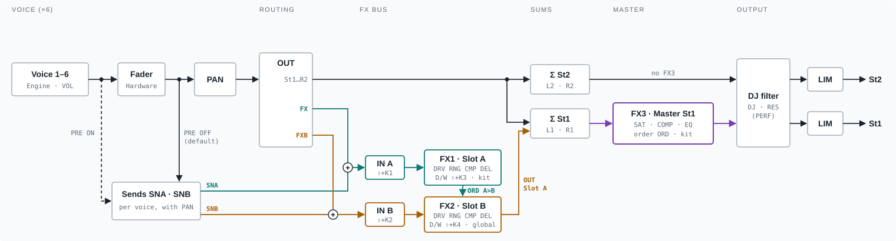
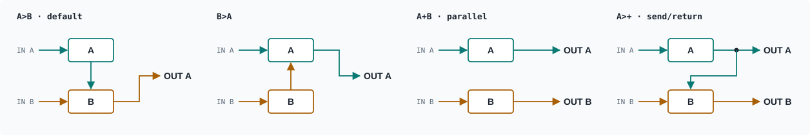
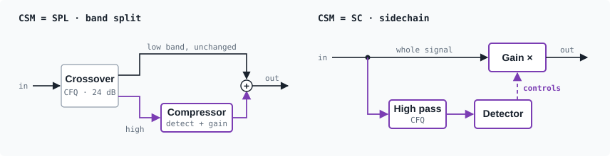

# Samples and voice INIT

User guide for the additions of the XT firmware for LXR-02. The base features of
OpenElixir-02 are described in [ENGINES.md](ENGINES.md) and [README_OPENELIXIR.md](../README_OPENELIXIR.md),
both taken unchanged from [OpenElixir-02 v1.2](https://github.com/tunefish777/openelixir-02/tree/v1.2).

## Importing samples

(User waves for oscillators and LFOs: see [User waves](#user-waves-1210); wave sets for the
wavetable engine in `SAMPLES/TABLES`: see [Wavetable engine](#wavetable-engine-1211-test).)

1. Create the folder `SAMPLES` in the top folder of the SD card and copy WAV files into it. Loop
   samples go into the subfolder `SAMPLES/LOOPS`.
2. Switch the LXR-02 on normally (without holding the encoder). If the folder changed since the
   last import, the display shows "Import x/y", then "Import+Verify OK".
3. The start screen then shows "Samples:" with the number of stored samples and, below, the memory
   used and available in seconds at 44.1 kHz mono ("Used 4.2/5.9s", with `BIGFLASH` "/17.8s").

The samples stay in the internal flash: they also play without SD card.

| | |
|---|---|
| Format | WAV, 16-bit PCM, mono or stereo (stereo is mixed to mono), any sample rate |
| File names | 8.3 format, e.g. `01KICK.WAV` (long names are not recognized) |
| Number | up to 31 (both folders together); slots S1..S31 follow the order of the names, numbers by value (`2KICK` before `10KICK`), letters without case |
| Total length | 511 KB in flash = about 5.9 s mono at 44.1 kHz (11.9 s at 22.05 kHz); with the 1.5 MB mode (`BIGFLASH`, see below) about 17.8 s (35.6 s at 22.05 kHz); a stereo file counts half its size |
| Ignored | names starting with `.` or `_` (e.g. the `._` files of macOS) |

- **Changes are detected by file names and sizes.** A file replaced by another one with the same
  name and exactly the same size is not imported again: rename it.
- **Files that are not 16 bit** are skipped ("Not 16bit, skip:" with the name); the others are
  imported.
- **Files that don't fit** are skipped in name order ("Full(5.9s) skip:", with `BIGFLASH`
  "Full(17.8s) skip:"); a later, smaller file may still fit. If not even one file fits:
  "Too big: x.ys / max 5.9s @44.1k" (or 17.8s), the flash stays unchanged.
- **Switch it off for about 10 seconds before switching it on again**: right after switching off, the OLED display can stay dark at the next start (the unit still works; switch off, wait, switch on).
- **A firmware update erases the samples.** Keep `/SAMPLES` on the card: the next normal start
  imports them again. Remove the `LXR*.img` file from the card after the update.

## Experimental: 1.5 MB sample memory

The chip of the LXR-02 (STM32F765VG) reports 1 MB flash in its flash size register. Its die usually has
2 MB: on the tested unit the area above 1 MB could be erased, written and read (first checked with
the LXR02Open port, which stores its samples there). ST doesn't guarantee that area (not tested by
the manufacturer, no specified data retention). Use it at your own risk:

- Create a file or a folder named `BIGFLASH` in `SAMPLES` (or in the top folder of the card). The
  name may have an extension (`BIGFLASH.txt`). The next start imports again with up to about
  **17.8 s** (44.1 kHz mono) instead of 5.9 s.
- The start shows `Big flash: on / 1.5 MB, testing`, the status after the import `Used x.x/17.8s`.
- `Big flash: no / dual bank`: the flash has another sector layout, 512 KB are used.
- Every sample is verified after writing. If something in the upper area fails: `Big flash
  failed / using 512K`, then the import is repeated into the normal 512 KB.
- Removing `BIGFLASH` imports again into the normal 512 KB.
- If the unit ever hangs at the start screen with `BIGFLASH` on the card: remove `BIGFLASH` (or
  start without card) - the firmware and the bootloader are not affected.

## Playing samples

On the OSC page of a voice, turn **Waveform** past Sin, Tri, Saw, Rec, Noi and PWM: S1..SN follow.

- **Coarse 60** plays the sample at its original pitch (the sample rate is taken into account).
- One-shot: the sample plays once per trigger; the AEG decay can end it earlier.
- FM from the mod oscillator works as for the other waveforms.
- Clicking into the waveform parameter (edit view) shows the file name, `L` for a loop and the
  slot, e.g. `KICK01        S3`.
- Works in every voice whose engine has a main oscillator. For snare, cymbal or hi-hat tracks give
  the voice the drum engine first (SHIFT + KIT, see [ENGINES.md](ENGINES.md)) if needed.

## Start and length

| Display | Parameter | Voices | Range |
|---|---|---|---|
| **Sta** (Start) | the PWM knob, while a sample is selected | all 6 | 0 = beginning of the sample |
| **Len** (Length) | 5th parameter of the OSC page | drum 1-3 | 0 = "all" (to the end) |

- Both values are shown in ms (in the 4-parameter view: `230` ms, `1.2` s, `12s`), on a quadratic
  scale: fine steps at the beginning, coarser towards the end.
- The length display shows the time that is actually played (limited by the end of the sample
  after the start).
- The start is taken at the trigger, including LFO or velocity modulation of PWM.
- Short fades avoid clicks: 32 frames fade-in only if the start is after the first frame, 64 frames
  fade-out only if the length cuts the sample. A sample started at 0 and played to the end is
  unchanged.
- Both are stored in kits. Kits without them play from the start to the end.

## Loops

Files from `/SAMPLES/LOOPS` are loop samples: they play from the start (Sta) to the end (Len, "all"
= end of the file) and then jump back to the start, until the amp envelope (AEG decay) ends the
sound. Drum voices have no gate, so a long decay keeps the loop going.

- With the amp decay at 127 a loop plays on without end (the envelope holds). Stopping the
  sequencer fades out every playing loop (1.2.11); the next trigger starts it again.
- Sta and Len set the loop points, shown in ms.
- The loop point is crossfaded with the audio just before the start (up to 256 frames, at most a
  quarter of the loop). With start 0 there is no audio before it: then a short fade out/in (32
  frames) avoids the click.
- The fade-in at a later start happens only once, not on every repeat.

## User waves (1.2.10)

Up to 8 single-cycle waveforms from **`SAMPLES/WAVES`**, for the oscillators and the LFOs.

- **Files:** WAV, 16 bit, mono or stereo, any length and rate. Each file is one cycle: at the
  import it is resampled to 1024 points (linear interpolation, the end leads back to the start).
  Stereo: only the left channel is used (a sum of channels with different phases could cancel).
  Best: one cycle starting and ending at a zero crossing, rising in the same direction, no DC
  offset; a jump between end and start adds a buzzing overtone.
  Not 16 bit: skipped and reported.
- **Numbering on their own:** `W1`…`W8` in the order of the names, numbers by value (`01SAW.WAV` =
  `W1`), independent of the samples. Samples added or removed don't move the waves, and the
  other way round. Replace a wave by a file with the same number (`01SAW.WAV` → `01PULSE.WAV`).
- **Oscillator** (OSC `WAV`): `W1`…`W8` come after the sample slots at fixed values (after all
  31 slots `S1`…`S31`), so kits keep their wave when samples change; unused sample slots are
  skipped when turning. The pitch follows the note like the built-in waveforms (no sample start
  or length); FM works. The edit view shows the file name. LFO/velocity modulation of a wave as
  base selects among the waves.
- **LFO** (`WAV`): `W1`…`W8` run like the built-in shapes (`FRQ`, `SNC`, `RTG`, `OFS` as phase),
  `W1.`…`W8.` are one-shots (one cycle per trigger after the `OFS` delay, then they hold their
  end value). A wave that isn't stored gives the middle value.
- **Memory:** 2 KB per wave in the sample flash (8 waves ≈ 0.2 s of sample time). Changes are
  detected like for the samples; a changed wave imports samples and waves again.
- **Status:** the start screen shows `Samples:12 W:3`.

## Modulated sample selection

When the waveform of a voice is a sample, modulating the waveform (LFO or velocity modulation with
the waveform as target) selects within a range of samples instead of switching to the built-in
waveforms:

- **Target:** `WAV` = the waveform of the main oscillator (OSC page). The other waveform targets
  are shown as `FWV` (FM/mod oscillator) and `CWV` (transient/click) and don't select samples.
- **The range starts at the selected waveform** (OSC page `WAV`) and covers **as many further
  samples as the modulation amount**: LFO page `MOD`, velocity modulation `AMT` (amount 4 with S5
  selected: S5..S9). Amount 0 = always the selected sample. The range starts at the waveform of the
  target voice (LFO `VOI`).
- The LFO or velocity value is quantized evenly onto the range: with 5 samples each fifth of the
  velocity (or of the LFO swing) selects one sample. The range ends at the last stored sample.
- Example hi-hats only: name the hat files so they follow each other (`5HAT_A` ... `9HAT_E`), select
  S5 as waveform and set the amount to 4.
- Velocity layers: soft to loud versions in a row, the softest selected, amount = number of layers - 1.
- **The sample is chosen at the trigger** and kept until the next trigger: modulation in between
  doesn't switch samples in the middle of a hit.
- **Round robin in order:** LFO waveform `CYC` (cycle) steps through the range, one sample per
  trigger (S5, S6, ... S9, S5, ...). It counts the triggers of the voice set with `RTG`, with
  `RTG` off those of the LFO's own voice. Rate and sync don't matter for `CYC`.
- **`CYC` on other targets** is a step counter: one step up per trigger, `MOD` = number of
  steps (about one value of the target per step), then it starts again, e.g. on `Coarse` with
  `MOD` 7 eight hits a semitone apart each.
- Random round robin: LFO waveform `RND`; with `RTG` on the voice the value stays the same for
  every hit (the LFO restarts), so leave `RTG` off and use a rate faster than the hits.
- A retrigger cuts the sample that still plays with a short fade (about 1 ms) instead of a click.
- With a built-in waveform as base the modulation works as before.

## Choke groups

Three choke groups per kit (A, B, C; 1.2.12, before one): a track of a group cuts the other
tracks of its group when it is triggered (e.g. several hi-hat samples on different voices, an
open hat cut by a closed one).

- AEG page of each voice: **`CHK`** = `off`, `A`, `B`, `C` sets the group of this track (one group
  per track). The edit view shows the group of every track on the left (e.g. `AA-B-CC`); in the
  edit view the voice buttons move their track to the next group (off › A › B › C › off).
- Group A is the former single group (kits of 1.2.11 and older load it as A; NRPN 99 sets A);
  B and C are stored in the kit data (part `CHK`) and unknown to older firmwares.
- The cut is a fade of about 2 ms; a choked track stays silent until it is triggered again.
- Tracks 6 and 7 (CL HH / OP HH) share one voice and cut each other anyway.
- Stored in the kit (group A in the parameter slot of the former 7th MIDI note setting). Kits
  without it: no choke group.

## Voice morph

Morphs the sound of one voice towards another voice of the active kit, like the kit morph (`MRP`)
but between two voices. Performance page, after `RES` of the DJ filter (scroll on with the encoder):

| Display | Function |
|---|---|
| `VMV` | the voice pair: `OFF`, `1>2`, `1>3` ... `6>5` (source > target); edit view `Voice 1 > 2` |
| `VMO` | amount 0..127: 0 = the source as set, 127 = the target's values |
| `VSW` | switch point of the source voice, 1..127 (default 64): from this `VMO` value on, switch-like values are the target's; one value per voice (edit view `Voice 1   64`); with `VMV` off it shows the active voice |

- Every sound parameter of the source voice moves towards the same parameter of the target voice
  (pitch, envelopes, filter, FM, sample start, LFO ...). Switch-like values (waveform/sample, filter
  type, on/off) change at `VSW` (default 64); level jumps there come from the sample or filter type
  changing at once.
- Engine specific parameters only morph if both voices run the same engine; the audio output
  routing never morphs.
- The settings of the voices stay as set: `VMO` = 0 or `VMV` = off gives the source its own sound
  back. Editing a parameter of either voice keeps the morph.
- `VMV` and `VMO` are not saved; after loading a kit turn `VMO` once to apply the morph again. Not a
  modulation target. The six `VSW` values are kept with the global settings (SAVE → Global or a
  project save).

## Performance and sequencer additions (1.2.4)

### Mod wheel → kit morph

The mod wheel (MIDI CC 1) on the **global MIDI channel** sets the kit morph (`MRP` on the
performance page): 0 = the active kit, 127 = the morph kit. CC 1 had no function before.

### Morph target quick access

`MRP` 0 → 127 morphs each parameter from its **start value** in the active kit to its **target
value** in the morph kit. In the edit view of a sound parameter (click the encoder), **hold SHIFT**: the top row shows
`Morph>` and the **target value** in the morph kit; turning the encoder
changes it there. Release SHIFT to see and edit the active kit's value again.

- With `MRP` above 0 the sound follows the change right away.
- The change is in the morph kit's copy in memory: a project save (Save → Project / All) stores it in
  that kit. Saving the active kit into the same slot overwrites it.
- Not for LFO/velocity/automation targets, the audio outputs, the choke group and engine specific
  parameters of slots whose engine differs in the morph kit.
- **SHIFT + encoder click** gives the morph kit the active value: the parameter no longer changes
  with the kit morph (e.g. keep `Coarse` and `Fine` of a voice while everything else morphs).

### Voices of the kit morph

Global settings (SHIFT + step button 12, CONFIG), second page: **`MRV`** = kit morph on/off for the
active voice; select the voice with its voice button while the page is shown. The edit view shows
the morphed voices on the left (e.g. `----56`: only snare/cymbal and hi-hats morph). Voices that
are off keep their own sound at every `MRP` value (also with the mod wheel). In the edit view the
voice buttons switch their voice on or off (1.2.11). Kept after a restart
when the global settings are saved (SAVE → Global); default: all voices morph.

### Lock trigger: velocity 0

A step with velocity 0 doesn't trigger the voice and sends no MIDI note; its step automation
(`P1`/`P2`) is still applied, like a "trigless lock". Patterns that used velocity-0 steps to cut a
sound no longer do.

**Clear the locks of a step (1.2.11):** SHIFT + encoder click on the step automation page (`dst`
`val` `dst` `val`) sets both locks of the selected step to off.

### LFO range display

The edit view of an LFO's `MOD` shows on the left the range its target moves in, e.g. `21..127`:
the target parameter's value ± `MOD`, limited to 0..127 (pitch-like values in their own units,
e.g. `-12..12`). To modulate between *a* and *b*, set the target parameter to (a+b)/2 and `MOD` to
(b−a)/2. No range for targets without a number scale (waveform, filter type ...).

### Instant pattern switching

Global settings (SHIFT + step button 12, CONFIG), second page: **`IPS`** (Pattern Instant)
on/off, kept after a restart when the global settings are saved (SAVE → Global). On: a pattern selected by hand starts on the **next step at
the same position** instead of at the end of the playing pattern. Automatic changes (pattern chains,
songs) still happen at the end of the pattern. Tracks shorter in the new pattern wrap at their length.

### LFO waveforms

New after `CYC`:

| Display | Waveform |
|---|---|
| `XTR` | exponential triangle (free-running) |
| `SI1` `TR1` `SU1` `SD1` `SQ1` `XU1` `XD1` `XT1` | one-shot sine, triangle, saw up, saw down, square, exp. up, exp. down, exp. triangle |
| `RN1` | one-shot random: a new random value at every trigger, held until the next one |

- One-shots run **one cycle per trigger** and then hold their end value. They start with a trigger of
  the voice set with `RTG`; with `RTG` off with a trigger of the LFO's own voice.
- **`OFS` is the delay** before the cycle starts (a fraction of one cycle: 64 ≈ half a cycle). The
  value stays at the start during the delay.
- `FRQ`/`SNC` set the length of the cycle.
- `SQ1` is 1 (high) in the first half of the cycle and 0 in the second half, before the start and
  after the end: a gate after each trigger.

## Step grid per track (1.2.7)

Each track of a pattern can run in its own step grid, e.g. hi-hats in 1/16 triplets against straight
drums. **SHIFT + LAST STEP** (step button 14): the bottom row shows `[16]  1/16    1` = length,
grid and the step length compared with 1/16. **Click the encoder** to switch the encoder between
length and grid (brackets). In the `ALL` mode (press LAST STEP again) it sets all tracks.

| Grid | Step length (1/16 = 1) | Steps per bar |
|---|---|---|
| `1/4` | x4 | 4 |
| `1/4T` | 8/3 | 6 |
| `1/8` | x2 | 8 |
| `1/16.` | 6/4 | 10⅔ |
| `1/8T` | 4/3 | 12 |
| `5/64` | 5/4 | 12⅘ |
| `1/16` | 1 (default) | 16 |
| `1/32.` | 3/4 | 21⅓ |
| `1/16T` | 2/3 | 24 |
| `1/32` | 1/2 | 32 |
| `1/32T` | 1/3 | 48 |

- The 1/16 tracks keep their timing unchanged; the other tracks step on the internal 96 ppq clock
  (24 ticks per 1/16). With MIDI clock all grids except `1/32.` and `5/64` fall on clock pulses.
- Each track loops at its own length, as before (polymeter). The pattern ends after its longest track
  in time.
- Stored in the pattern (a small block after the pattern data). Older patterns load as `1/16`; other
  firmwares ignore the block and play all tracks in 1/16.
- Roll on a grid track repeats on the track's own steps. Shuffle moves grid tracks slightly; live
  recording is quantized to the 1/16 grid.

## Step flam: ratchets and roll locks (1.2.8)

The step parameter flam (step mode) has more values after `X2` … `X8`:

| Value | Effect |
|---|---|
| `X12`, `X24` | 12 or 24 repeats within the step |
| `X4+`, `X4-` | 4 repeats with a rising / falling velocity slope (25 … 100 % of the step velocity) |
| `1/8`, `1/4`, `1/2`, `1/1` | **roll lock**: the step repeats every 2, 4, 8, 16 steps of its track (like the slower PERF roll rates) until the next active step of the track |

On grid tracks the repeats follow the track's own steps. Other firmwares play these steps once.

## Trigger tracks and LFO start (1.2.9)

Any track can additionally act on another track. SHIFT + LAST STEP shows the length and the grid
of the track; **click the encoder** to go on to the trigger mode (`Trg [OFF]`) and, with a mode,
to the target track (`Trg  RST  >[T3]`), then to the LFO start (see below); another click returns
to the length.

| Mode | Each active step of the trigger track ... |
|---|---|
| `OFF` | nothing (default, older patterns) |
| `RST` | sets the target back to its step 1, which plays at once; otherwise the target runs as usual |
| `MUT` | mutes the target for as long as the step lasts, step by step |
| `CLK` | moves the target on by one step, which plays for one step length; then the target waits for the next impulse |

- Steps of any velocity count; with velocity 0 the step only triggers and doesn't play its own
  sound (lock trigger).
- The step grids of both tracks are kept: a `1/16T` trigger track resets a `1/16` target on its
  triplet steps, a `CLK` target plays each of its steps with its own step length.
- A track can be the target of one trigger track or LFO start only (targets in use are skipped
  when choosing). Stored in the pattern; other firmwares ignore it.

### LFO start

On the LAST STEP page of a track, after the trigger settings: **`LFO>[T3]`** = the LFO of this
track's voice (track 7: voice 6) starts track 3 (`OFF`, `T1` … `T7`), then the timing **`NXT`** /
**`NOW`**.

- Each start of the LFO's waveform (a new cycle, a restart by `RTG`, a one-shot after its `OFS`
  delay) starts the target at step 1: with `NXT` on the next step of the target's grid (stays in
  time), with `NOW` at once.
- The target plays to its last step and then waits for the next start. If the LFO cycle is
  shorter than the target, the next start comes first: it loops the part up to there.
- Not counted: a restart of the LFO caused by the target's own trigger (`RTG` on the target's
  voice), otherwise the target would keep restarting itself.
- Until the first start the target is silent. With `SNC` the starts fall on the beat;
  free-running LFOs give starts that drift against the pattern: with `NXT` a cycle of e.g. 17.5
  steps restarts the target alternately after 17 and 18 steps, with `NOW` exactly after each
  cycle, but between the steps of the other tracks.

### Example: generative restarts with three LFOs

A chain of slow modulations; target track 4 (e.g. a 32-step pattern, longer than the LFO cycle,
so each restart cuts it at another point). Starting values, to be adjusted by ear:

| LFO of | Role | Settings |
|---|---|---|
| voice 3 | starts track 4 | `SAW` or `SIN`, `FRQ` medium (cycle about 1–2 bars), `SNC` off, `RTG` off; LAST STEP of track 3: `LFO>[T4]`, `NXT` |
| voice 2 | varies the rate of LFO 3 | `VOI` 3, `DST` `FRQ`, `RND`, `FRQ` slow (a new value every 2–4 bars), `MOD` 20–40 |
| voice 1 | varies how much LFO 2 acts | `VOI` 2, `DST` `MOD`, `SIN` or `XTR`, `FRQ` very slow (cycle 16–32 bars), `MOD` 30–50 |

Track 4 then restarts almost evenly for a while, then at irregular, jumping distances; `NXT` keeps
it in time. Set the modulated values (`FRQ` of LFO 3, `MOD` of LFO 2) to the middle of their
range so the modulation isn't cut at an end. The voices 1–3 still play their own tracks.
Variations: `NOW` (restarts between the steps), track 4 on `1/16T`, `PRB` < 100 % on its steps.
- The track whose page it is plays on as usual; it can have a trigger target and an LFO target at
  the same time. Each target is controlled by one source only: tracks that are already the
  target of a trigger or an LFO start are skipped when choosing a target. Stored in the pattern.

## FX signal flow

From the voice to the jacks, with the default slot order `A>B` (⇧ = SHIFT, K1 … K4 = the four
parameter knobs):

- `VOL` is part of the engine and always acts on output and sends. The fader acts on both with
  `PRE` `OFF` (default), with `PRE` `ON` only on the output. `OUT` = `FX`/`FXB` always keeps it.
- With `A>B` slot B is an insert after slot A: with the mix of FX2 at 100 % the direct sound of
  FX1 is gone, it is only heard inside FX2's effect. `A>+` keeps it.
- FX3 only sits on `St1` (and follows it to the `St2` jacks without a cable in `St1`).

The order of the FX slots (`ORD` on the FX1 page):

The crossover `CFQ` of the FX3 compressor, as band split or sidechain filter (`CSM`):

## Second FX slot (1.2.8)

Next to the kit's FX (`FX1`, slot A) there is a project FX (`FX2`, slot B) with the same effects:
`OFF`, `DRV` (distortion), `RNG` (ring modulator), `CMP` (compressor), `DEL` (delay).

- **Slot A** is the FX of the kit as before (**SHIFT + FX**, step button 15; its type is shown as
  `FX1`). **Press SHIFT + FX again** for **slot B**: its type is shown as `FX2`, the edit view shows `FX B`. Its parameters
  are the same as slot A's (type, `OUT`, mix, effect parameters).
- **Routing:** a voice's output (`OUT` on its mix page) `FX` goes to slot A, the new **`FXB`** to
  slot B (100 %, nothing dry).
- **Sends:** **`SNA`** (into slot A) and **`SNB`** (into slot B) on the AEG page of the voice
  (0..127, default 0 = no send), stored in the kit. They work besides the voice's output (`OUT`
  `St1` … `R2`), both at once if wanted, before the voice's pan. Set the mix of the slot to fully
  wet for a classic send/return, otherwise the dry bus signal is heard twice.
- **Sends with `OUT` = `FX`/`FXB`:** the voice is already fully in that slot, so a send into the
  same slot only raises its level there (up to twice); a send into the other slot feeds both
  slots, which can be interesting too.
- **Kit format:** the send levels are a small block after the engine block of the kit file.
  Older kits load with 0; OpenElixir-02 ignores the block. The outputs `1+A` … `R2B` of the
  first 1.2.8 test versions play as the output only (set the send again).
- **Setup page:** on both FX pages, turn the encoder past the last parameter of the effect: `SYA`,
  `ORD` and `PRS` on slot A's page, `SYB` and `PRS` on slot B's page.
- **FX presets (1.2.11):** `PRS` on the setup page. Click (edit view), turn to choose, click again:
  the preset is loaded into the slot (type, mix and all values of the effect, delay sync; not the
  output, sends or `ORD`). The list:
  - factory presets (same for all projects): delay `Slap`, `Dub 3/16`, `Dotted 1/8`, `Ping 1/8`,
    `Tape 1/4`, `Trip 1/16T`; distortion `Warm Tube`, `Hot Tube`, `Fold`, `Clip Fuzz`; compressor
    `Glue 2:1`, `Punch 4:1`, `Squash 8:1`, `Parallel`; ring modulator `Metal`, `Bell`, `Robot`;
  - the user presets `U1` … `U8` of the project;
  - `Save to U1` … `U8`: a click saves the slot's settings there (`(rpl)`: replaces one). They are
    in `FXPRESET.BIN` in the project folder (the project must have been saved once) and go along
    with a project save. Both slots share the list.
- **FX routing** (`ORD`):
  - `A>B` (default): slot A, then slot B; voices on `FXB` only go through B. The chain goes to the
    `OUT` of slot A. With slot B `OFF` everything sounds as before.
  - `B>A`: slot B, then slot A (to the `OUT` of slot A).
  - `A+B`: side by side, each slot to its own `OUT`.
  - `A>+` (1.2.10): send/return chain: slot A to its own `OUT` and into slot B, slot B to its own
    `OUT`. Unlike `A>B` the effect of slot A stays audible when slot B is fully wet.
  - Note for `A>B`: slot B is an insert after slot A. With the mix of slot B at 100 % the direct
    sound of slot A is gone, it is only heard inside slot B's effect (e.g. in its echoes).
- **Delay tempo sync** (setup page): `SYA` for slot A, `SYB` for slot B: `OFF`
  (free time and range as before), then from long to short `1/4`, `1/8.`, `1/4T`, `1/8`, `1/16.`,
  `1/8T`, `5/64` (shown `564`), `1/16`, `1/32.`, `1/16T`, `1/32`, `1/32T` (the step grids and 1/8.). Follows the tempo (also external clock). The delay is at most about 0.74 s
  (ping-pong 0.36 s): longer values are limited.
- Slot A and the FX routing `ORD` are stored in the kit (`ORD` in the kit's extra block, older
  kits: `A>B`); slot B (the project FX) and the sync are kept with the global settings (SAVE →
  Global) and in the project file.
- CPU: each slot costs about as much as one effect did before (measure with the CPU meter build).

## Master bus FX3 and FX knobs (1.2.10)

A third FX slot, fixed at the end of the chain on the stereo output `St1` (after FX1/FX2, before
the DJ filter and the limiter): saturation, a compressor and an EQ, in any order.

- **SHIFT + FX three times** (FX1 → FX2 → FX3, then FX1 again). Stored in the kit (kit extra
  block; older kits: off).
- `SAT` saturation (0 = off): soft clipping, up to +24 dB into the curve, level compensated. The
  curve has headroom (its knee at 3 × full scale, as the sum before the limiter goes above full
  scale), and `SAT` 1 … 16 also fade the saturated signal in: low values leave a loud mix nearly
  clean (1.2.11; before, `SAT` 1 already distorted it).
  Symmetric, so it adds odd harmonics (3rd, 5th …): edgier, more bite. `BIA` (last FX3 page)
  makes the curve asymmetric depending on the level, like a tube stage: quiet signals stay
  symmetric and clear, loud ones get even harmonics (2nd, 4th …: octaves, fuller and warmer).
  `BIA` sets how far the operating point moves (0 = always symmetric). The DC is removed
  (high pass about 20 Hz); `BIA` only acts with `SAT` above 0.
- `FRQ` split: `off` = full band, otherwise 40 Hz … 10 kHz, logarithmic (about 16 steps per
  octave, 200 Hz ≈ value 37): a 24 dB/oct crossover (Linkwitz-Riley), only the band above it is
  saturated, the lows stay clean.
- Compressor (feed-forward, stereo linked, peak, hard knee; level and gain computed in dB, attack
  and release as exponential curves): `CFQ` crossover as `FRQ` (`off` = full band), `CSM` what it
  does: `SPL` = band split (only the band above it is detected and compressed, the lows pass
  unchanged), `SC` = sidechain filter (only the band above it drives the compressor, the whole
  signal is compressed: the bass no longer pumps the mix), `TRE` threshold −48 … 0 dB, `RAT` ratio 1:1 … 20:1
  (0 = off), `ATK` attack 0.1 … 100 ms, `DEC` release: `AUT` (first value) = follows the tempo,
  a 1/16 note (125 ms at 120 BPM), otherwise 20 … 1000 ms.
- EQ (next page): `LO` low shelf 100 Hz, `F1` `G1` `Q1` mid 1, `F2` `G2` `Q2` mid 2, `HI` high
  shelf 8 kHz. Gains −15 … +15 dB (64 = 0 dB, a band at 0 dB is off), frequencies 20 Hz …
  16 kHz, Q 0.3 … 8 (both logarithmic). Defaults: mids at 300 Hz and 3 kHz, Q 1.
- Last page: `ORD` = order of the three stages: `SCE` (saturation, compressor, EQ; default),
  `CSE`, `ESC`, `ECS`, `SEC`, `CES`. Output: `AMU` = auto make-up gain: `OFF`, `FIX` (adds half the
  reduction a 0 dBFS peak gets, from `TRE` and `RAT`), `ADA` (adaptive: follows the average
  reduction, about 1.5 s, so compressed and dry signal are about as loud and `D/W` only changes
  the character); `GAI` make-up 0 … +24 dB on top, `D/W` mix of the compressor (parallel
  compression, 127 = fully compressed).
- Page order: `SAT` `FRQ` `CFQ` `CSM` | `TRE` `RAT` `ATK` `DEC` | `LO` `F1` `G1` `Q1` |
  `F2` `G2` `Q2` `HI` | `ORD` `AMU` `GAI` `D/W` `BIA`.
- With band split, `AMU`/`GAI` and `D/W` act on the compressed band only.
- PERF page: `DJ`, `RES`, `SAT`, `FRQ` on the second half of the first page, then `SHU`, `VMV`,
  `VMO`, `VSW`, `OSX`, `CMX`, `CVL` (FX3 values: the same kit values as on the FX3 page).
- With `SAT`, `RAT` and `GAI` at 0 and all EQ gains at 0 dB the bus is off and the sum stays
  unchanged.
- CPU: the CPU meter build (`cmake -DLXR_CPU_METER=ON`) shows FX3 as `M` on its second page
  (SHIFT + PROJECT), in percent of an audio block.
- Edit view: top left the peak levels of `St1` / `St2` before FX3 in dBFS (`-99` = silent), bottom
  left the state: `byp` = off, `on-4A` = on, highest gain reduction 4 dB, on `St1` (`B` = FX3
  follows `St1` to the `St2` jacks).
- Only `St1`: voices on `St2`, `L1` … `R2` don't pass through FX3. Without a cable in `St1` the
  firmware plays `St1` on the jacks of `St2` (stock behaviour): FX3 then works there, on
  everything that comes out of these jacks.

**SHIFT + knobs** (all pages except LOAD/SAVE): hold SHIFT and turn

| Knob | Function |
|---|---|
| 1 | input gain FX1 (slot A) |
| 2 | input gain FX2 (slot B) |
| 3 | mix FX1 |
| 4 | mix FX2 |

The display shows the values for 1.5 s (`In dB A +0 B -6`, `Mix % A 50 B100`). The input gain
scales everything going into the slot (outputs `FX`/`FXB` and all sends `SNA`/`SNB`), −∞ … +12 dB,
center = 0 dB; it is kept with the global settings (SAVE → Global) and in the project file. The mix
of FX1 is stored in the kit, of FX2 with the global settings, as before.

**Pre-fader sends** (CONFIG, second page, `PRE`, global): `OFF` (default) = the sends `SNA`/`SNB`
come after the voice's volume fader, as before. `ON` = before the fader: the fader only sets the
dry signal, the voice's level in the effects stays (fader down = only the echo / the effect is
left). The effect levels are then set with SHIFT + knob 1 / 2 (input) and 3 / 4 (mix). `VOL` on the
mix page still acts on both. Voices with `OUT` = `FX`/`FXB` keep their fader in either mode.

## Track 7: own waveform, pitch, sends and pan (1.2.11)

Tracks 6 and 7 play one voice (slot 6, the hi-hats by default). Besides its own amp decay,
track 7 can now have its own waveform, pitch, sends and pan. The pages of track 7 (with every
engine on slot 6) show them under the same names in place of the shared parameters; the edit
view names them "Trk7 …". The shared ones are set on the pages of track 6.

| Displayed name | Name | Description |
|---|---|---|
| `WAV` | Trk7 wave | OSC page: `=T6` = the waveform of track 6 (default), else any waveform, sample or wave for the triggers of track 7 |
| `COA` | Trk7 coarse | OSC page: −24 … +24 semitones on top of the voice's pitch (`COA` of track 6) for the triggers of track 7 (0 = as track 6) |
| `SNA`, `SNB` | Trk7 send A/B | AEG page: `=T6` = the sends of track 6 (default), else 0 … 127 into FX slot A/B for the triggers of track 7 |
| `PAN` | Trk7 pan | MIX page: `=T6` = the pan of track 6 (default), else −63 … +64 for the triggers of track 7 |

Example: closed and open hi-hat samples on one voice: `WAV` of track 6 = the closed one, `WAV` of
track 7 = the open one, with `SNA` of track 7 only the open one into the reverb. Both still cut
each other (one voice). The voice takes the sends and pan of the track that triggered last; the
sends ramp over one audio block (about 1 ms) when they change, the tails already in the FX ring
out. Everything else is shared: fine tune, filter, LFO, start and length, volume (fader) and
outputs. With the FM hi-hat engine track 7's `COA` shifts the
carrier only, which changes the timbre more than the pitch. Stored in the kit (part `TR7`).

## Cue on St2 (1.2.11)

Pre-listening of tracks on the St2 output, like the cue of a DJ mixer.

- **SHIFT + step button 1-7** (DRUM1 … OP HH) cues the track or takes it out, on every page.
  Cued tracks blink at their voice button; the display shows the cued tracks for a moment.
- As long as a track is cued, **St2 carries the cue**: the cued tracks before their fader
  (pre-fader listening), with their pan, without FX. St1 stays as it is; what is routed to St2
  (voice outputs, FX returns) plays on St1 meanwhile. Nothing cued: St2 is a normal output again.
- **Muted tracks** that are cued are still triggered, but heard on the cue only (no MIDI note,
  no FX sends). Unmuting them brings them to St1 (also a sound that is still playing). With the
  fader down a cued track is heard on the cue only as well.
- PERF page, after `OSX`: **`CMX`** = cue mix: 0 = cue only … 127 = main (St1 with FX3 and DJ
  filter) only; **`CVL`** = cue level (100 = unity). Both are global settings.
- The cue needs a cable in St1 (otherwise St1 plays on the jacks of St2: no cue, the display
  shows `no St1!`).

## OSX: voices without the global sample rate (1.2.11)

`OSX` on the PERF page (after `VSW`): `on` = the active voice doesn't follow the global sample
rate (`SR` on the PERF page, target `0sr` of the step automation and the LFOs) and keeps only
its own `SRT` (MIX page). Edit view: the excluded voices on the left, e.g. `1--4--`; there the
voice buttons switch their voice (the encoder switches the active one). Track 7
belongs to voice 6. Default: off for all voices. Stored in the kit (part `OSX`).

## LFO 2 and the LFO of track 7 (1.2.11, test)

Each voice has a second LFO, and track 7 its own LFO. Press the LFO button of a voice again on
the second LFO screen: the display shows "LFO 2" in the edit view and the same parameters
(`FRQ`, `SYN`, `MOD`, `WAV`, `RTG`, `OFS`, `VOI`, `DST`) as the LFO; one more press goes back to
the LFO. Selecting another page or voice starts with the LFO again.

- **LFO 2** works like the LFO of the voice, with its own target (also another voice's).
  Without a target (`DST` off, the default) it is off and costs no time.
- **Track 7:** its LFO page is the LFO of track 7 ("Trk7 LFO"). With a target it acts while slot 6
  plays a trigger of track 7, instead of the LFO of voice 6; the next trigger of track 6 brings
  back the LFO of voice 6. Without a target, track 7 keeps the LFO of voice 6 (as before). Its
  `RTG` `v6` and its own one-shot start are the triggers of track 7. LFO 2 on the pages of track 7
  is the LFO 2 of voice 6, for both tracks.
- The settings are kit data (part `LFX`, also in voice load and INIT templates): not morphed,
  not recorded as step automation, no MIDI CC.

## Fast rolls: 1/24, 1/32, 1/48 (1.2.11)

The PERF roll rate `ROL` has three more values between `16` and `64`: `24` (1/16 triplets),
`32` (1/32 notes) and `48` (1/32 triplets). They work like the other rates and follow the tempo;
the repeats sit on the sequencer's tick grid (24 ticks per 1/16 step), like the flams.

## Step accent (1.2.11)

Each step can be accented: `ACC` on the first step page (after `PRB`), on/off for the selected
step. An accented step plays louder by `ACA` (CONFIG, second page, last position, global):
1 … 127 = +0.1 … +6 dB, default 64 (about +3.5 dB). The accent raises the voice's fader level for
that trigger (so with `PRE` = `ON` the sends stay as they are); the next trigger without accent
plays at the normal level again. Stored in the step (bit 7 of its note; older patterns have no
accents, other firmwares play an accented step with a wrong pitch). Copying a step or a pattern
copies its accents.

## Random voice (1.2.11)

SHIFT + encoder click on a voice page (OSC, AEG, MOD, FM, transient, filter; not in the edit
view) changes the sound of the active voice at random, by the strength `RND` (PERF page, after
`CVL`, global, default 32): values move by up to ±`RND`/127 of their range around the current
setting, switch-like values (waveform, filter type, …) change with that probability. The volume,
pan, output, sends, LFO, choke group and engine stay. The display shows how many values changed;
press again for the next variation, voice LOAD (or not saving) brings the old sound back.

## Random octave (1.2.12, test)

`OCT` on the OSC page of each voice (VOICE 7: its own value) shifts every trigger by a random
number of octaves: `+-1`, `+-2`, `+-3` up or down, `+1`, `+2`, `+3` only up, `-1`, `-2`, `-3` only
down, each with 0 included (`+-1` = −1, 0 or +1, equally likely); `off` = none (default). It moves
the note of the trigger, so it works with samples and every engine (all oscillators of the cymbal
and hi-hat); the note is limited to 0 … 127. Pads, MIDI notes and the sequencer all use it; the
MIDI note sent stays. Stored in the kit (part `OCT`, also in voice load and INIT templates).

`OCT` on the step page (after `SFT`) replaces it for the selected step: `vce` (as the voice,
default), `off`, `+-1`, `+-2`, `+-3`, `+1`, `-1`. Stored in the pattern, in the free top bits of the
step's probability and lock values; copying a step copies it. Other firmwares play a step with an
`OCT` value whatever its probability, and its locks with wrong values.

## Gates (1.2.13, test)

Hold a step and press a later one (also on another page, switch with the bar buttons while
holding): the first step triggers and holds to the end of the second one; the steps after it up
to the second are held. The held steps light up, don't trigger (their locks act, e.g. a pitch
change during the gate) and are switched off as steps.

- The amp envelope holds its full level from the end of the attack while the gate is open, then
  the decay acts as the release. Loop samples play as long as the gate; a one-shot sample still
  ends with its length. `modal`: the modes ring on while the gate is open, `dmp` then acts as the
  release.
- MIDI: the note ends with the gate (otherwise it ends with the next note of the track).
- Ratchets on the first step: each repeat holds to the next, the last one to the end of the gate.
- The gate ends at the latest when the track arrives at a step that isn't held: the end of its
  range, a loop jump back, RST of a trigger track; the stored gate stays.
- Removing the first step removes its gate; setting a held step makes it a normal step that
  ends the gate before it.
- Stored in the pattern (block `GAT1` after the start positions); copying steps, duplicating
  and copying tracks or patterns take the gates along. Other firmwares play the first step as a
  normal trigger and the held steps as off.

## Prepared steps (1.2.13, test)

Hold the voice button of the track and press a step: the step is marked as prepared (or no
longer). The mark is a property of its own and doesn't switch the step: a step press switches
it on and off as before, the mark stays. While a prepared step is off, its LED flashes on the
beat like the PLAY button (stopped: about twice a second), so steps meant to be set live stay
visible; a step that is on lights as usual. A step needs no other settings to be prepared.
Stored in the pattern (block `PRP1` after the gates); copying steps, duplicating and copying
tracks or patterns take the mark along.

## Start, loop, copying steps (1.2.12, test)

- **Start**: on the LAST STEP page each encoder click moves on: length › `Start` › grid › trigger
  › LFO start. The track plays from `Start` to its last step (`Start [5] > 16` = steps 5 … 16);
  the pattern ends after the longest such range. RST and LFO starts begin at `Start`. In the ALL
  mode it sets all tracks. Stored in the pattern (block `STA1` after the LFO starts).
- **Loop**: per track: `SHIFT + PROJECT` turns the loop mode of the active track on (step 13
  blinks while that track is active) and off; several tracks can loop at once, each in its own
  range. Hold a step and
  press a second one; the first can be on another page (switch with the bar buttons while
  holding). The active track then loops from the first to the second step, in its own grid,
  backwards if the second step lies before the first. At the track's next step it plays on from
  there if that step lies inside the loop, else it starts with the loop's first step. A single step press ends the loop mode of the track, a pattern change ends
  the loops;
  the step buttons don't edit steps in the loop mode. As a trigger target, RST and an LFO start
  jump to the loop's first step and CLK moves on inside the loop; as a source the loop's steps
  send the impulses. Not stored.
- **Copy steps**: hold `COPY` and press steps of the active track (also across pages), then
  release: they are copied with all their settings. Each following step press pastes them from
  there, each at its distance to the first copied step, as often as wanted, also into other
  tracks with the same engine (another engine: "Not pasted"); steps that would lie behind the
  track length are left out, the steps in between are kept. Pressing `COPY` ends the pasting.
- **Duplicate**: `SHIFT + MORPH` copies the played range (start … last step) behind the last step
  and lengthens the track by it: length 6 becomes 12, 20 becomes 40, at most 64.
- **Undo / redo**: `COPY + ‹` undoes the last change of the shown pattern (steps and their
  settings, paste, duplicate, gates, prepared marks, length/start/grid), `COPY + ›` redoes it. One
  step; turning one value counts as one change. Showing another pattern ends it.
- **Deviation from the original**: there `COPY + ›` fills the next bar with the previous one;
  here that is `SHIFT + MORPH` (duplicate, also lengthens), and `COPY + ‹ / ›` are undo / redo.

In the development build (CPU meter) `SHIFT + MORPH` and `SHIFT + PROJECT` keep their meter
functions, so loop and duplicate are missing there.

## WAV recorder (1.2.11)

The last PERF screen records the mix as a WAV file to the SD card, in real time: 16 bit stereo,
44.1 kHz, the signal of the St1 jacks after FX3, DJ filter and limiter (without a cable in St1 the
signal of the St2 jacks, see [cue](#cue-on-st2-1211)).

| Displayed name | Name | Description |
|---|---|---|
| `REC` | Record WAV | length: `x1`, `x2`, `x4` = 1, 2 or 4 passes of the longest track of the playing pattern, `end` = until the sequencer stops. Shows `arm` while armed, `rec` while recording |
| `RST` | Rec start | `ply` = with PLAY, `pat` = at the next pattern start, also while the sequencer runs |

**Encoder click in the edit view** of `REC` or `RST` arms the recorder: it creates the next free
file `REC/REC001.WAV` … `REC999` and reserves the space. With `ply` the recording starts with the
next PLAY; with `pat` at the next start of the pattern (the longest track back at step 1), or
with PLAY when the sequencer is stopped. It ends after the passes, at STOP, or with another click;
the display shows the file and its length (`Saved REC003 1:32`). A click while armed deletes the
empty file again. `REC` and `RST` are global settings (SAVE → Global) and stay as they are after a
recording. If the card is too slow, the gaps are counted and shown (`2 gaps`): use a fast card
(class 10 / U1). Card full: the recording ends there and keeps what was written. Loading or
saving kits and projects during a recording can cause gaps.

## Modal engine (1.2.11, test)

A new voice engine, `modal`: a physical model of a struck body (membrane, bar, string, bell,
plate, glass). Six resonators ring at the body's mode frequencies; a mallet or a noise burst
strikes them. Choose it like the other engines (SHIFT + KIT, `modal`); the voice uses the pages
of the drum engine:

| Page | Displayed name | Name | Description |
|---|---|---|---|
| OSC | `COA`, `FIN` | Coarse, Fine | the pitch of the first mode (the note follows) |
| MOD | `DMP` | Damping | decay time of the modes, 30 ms … 6 s |
| MOD | `INH` | Inharmonic | stiffness: the higher modes spread upwards (piano-like strings, detuned bars) |
| MOD | `POS` | Strike pos. | edge (0) … centre (127): modes with a node at the strike position get quiet |
| FM | `HRD` | Hardness | soft (0: long pulse, dark) … hard (127: click, bright) mallet |
| FM | `MAT` | Material | 0 = all modes ring equally long (metal) … 127 = high modes die fast (wood) |
| FM | `MDL` | Model | `mem` membrane, `bar` free bar (marimba), `str` string/tube, `bel` bell, `plt` plate, `gls` glass/bowl |
| FM | `EXC` | Exciter | `mal` mallet pulse, `nse` noise burst |

The amp EG still applies (new voice: decay 110, so the damping sets the length), so do the filter,
the transient sample (it strikes the resonators too, e.g. a click or noise as exciter), the
distortion, the LFO, velocity and the mix page. A new strike adds to the ringing modes instead
of restarting them. LFO, velocity and step automation targets on the engine settings are named
as in the table. Stored in the kit as engine 4: firmwares without it (OpenElixir-02, XT / OE02-Samples+
before 1.2.11) play such a voice with its stock engine. MIDI: NRPN 98 value 24 + slot (0 … 5).
A test: the sound and its parameters may still change.

## FM2 engine (1.2.11, test)

`fm2`: 2-operator FM percussion. A sine carrier is phase modulated by a sine modulator whose
index has its own decay, with feedback on the modulator: bells, metallic hits, FM toms and
kicks, snaps. The pitch EG works as for the drum. Drum pages; on the FM page:

| Displayed name | Name | Description |
|---|---|---|
| `RAT` | Ratio | modulator : carrier, `.50` `.75` `1` `1.4` `1.5` `2` `2.5` `2.8` `3` `3.5` `4` `5` `6` `7` `8` `11` (non-integer ratios sound inharmonic, metallic) |
| `IDX` | FM index | modulation depth at the strike (0 = pure sine) |
| `IDC` | Index decay | how fast the index falls to 0: 5 ms … 4 s (short = a bright attack, then a sine) |
| `FBK` | Feedback | modulator onto itself: towards noise |

The MOD page keeps the drum's pitch EG (decay, slope, amount); the transient page adds its click
like with the drum. MIDI: NRPN 98 value 30 + slot.

## Wavetable engine (1.2.11, test)

`wavetable`: an oscillator that scans through a set of single-cycle waves (frames). The pitch EG
also sweeps the position, so a hit can start bright and settle on a sine. Drum pages; on the FM
page:

| Displayed name | Name | Description |
|---|---|---|
| `SET` | Table set | `bas` = sine › triangle › square › saw, `usr` = made from the user waves W1 … W8 (`SAMPLES/WAVES`), `all` = `bas`, then `usr`, `t1` … `t4` = the wave sets of `SAMPLES/TABLES` (missing set: `bas`) |
| `POS` | Wave pos. | position in the set: 0 = first frame, 127 = last |
| `SWP` | Pos. sweep | how far the pitch EG moves the position up at the strike; it moves back to `POS` as the EG decays |
| `SCN` | Scan mode | `smo` = crossfade between neighbouring frames, `stp` = frame by frame, `pp` = back and forth: the first half of the range runs through the set, the second half back (an LFO saw then scans forth and back without a jump), `pps` = back and forth, frame by frame |

**How a set is played.** The position (`POS` + `SWP` × pitch EG, plus LFO or step automation on
`POS`, limited to 0 … 127) is spread evenly over the frames of the set; between two frames the
engine crossfades. All frames are prepared when they are made:

- **Lined up:** each frame is turned so that its fundamental starts at the same phase. Crossfades
  then don't cancel the fundamental (no thin middle).
- **In-between frames:** between two waves of a set the frames are calculated from their
  harmonics (level and phase of each one interpolated), not mixed: the timbre changes like in a
  real morph. `bas` has 7 between each pair (25 frames), `usr` 3, a table file up to 7 (at most 64
  frames per set).
- **Band limited by pitch:** each frame has versions with 127, 63, 31, 15, 7 and 3 harmonics. The
  engine takes the one that stays below about 20 kHz at the played pitch, crossfading between them
  while the pitch moves (no aliasing, no jump at octave borders). Above about 6.6 kHz it fades to a
  sine.

**Own sets:** WAV files in `SAMPLES/TABLES` (up to 4, `t1` = first name), imported at the start
like the samples:

| | |
|---|---|
| Format | WAV, 16 bit, 24 bit or 32 bit float, mono or stereo (left channel) |
| Cycle length | from the file's `clm` chunk (Serum and Vital write it, e.g. 2048), without it: 2048 for long files divisible by 2048, otherwise 256 (WaveEdit, 64 × 256); a short file (up to 4096 points) is one cycle |
| Frames | the cycles in file order; more than 64: 64 evenly picked; fewer: in-between frames added (up to 7 per pair, 64 frames at most) |
| Memory | 1.25 KB per frame (256 points plus the band limited versions): a set of 64 frames about 80 KB = 0.9 s of samples |
| Priority | after the samples: what doesn't fit any more is skipped (as samples) |

A table file that can't be used is skipped with its reason on the display ("Table format?:",
"Table too short:", "Table unreadable:"). The edit view of `SET` shows the file of the chosen set,
or `none>bas` when it isn't stored (then the basic set plays).

The set `usr` is made from the user waves in the same way (with 3 in-between frames per pair; 8
waves: 29 frames, 36 KB). The start screen shows the number of sets (`S:12 W:3 T:2`); the memory
used includes them. Importing tables takes a few seconds (the harmonics of every cycle are
calculated).

The MOD page keeps the drum's pitch EG (decay, slope, amount); with the amount at 0 it only sweeps
the position. MIDI: NRPN 98 value 36 + slot.

## Modulation targets of the added engines (1.2.11)

The settings of `modal`, `fm2` and `wavetable` are LFO, velocity and step automation targets on
every voice, named as on their pages (e.g. LFO `dst` `pos`, step `dst` `1po`). On voice 4 the
first setting (`MDL`, `RAT`, `SET`) and on voice 6/7 the last one (`EXC`, `FBK`, `SCN`) have no
place of their own in the stock target list; there they take the place of the oscillator
waveform target (`wav`), which these engines don't have. Kits keep their targets.

## Voice INIT

Hold **LOAD** and press the step button of a voice (1-7). From kit 0 turn the encoder one step back:
the row **"INIT: Project"**, "INIT: Global" or "INIT: Factory" shows where this voice's INIT comes
from. One step further is "Change Project" as before. Click the INIT row for its actions:

| Action | |
|---|---|
| Load INIT | loads the voice from the project template, else from the global template, else the factory values of its engine |
| Save to Project | stores this voice of the active kit in the template of the listed project |
| Save to Global | stores this voice in the global template |
| Del Project INIT / Del Global INIT | removes this voice from the template (second click to confirm: "Delete? Click") |
| Back | back to the kit list |

- A template holds each voice separately: saving or deleting changes only this voice.
- A template voice contains everything of the voice: engine, sound parameters, LFO and velocity
  settings, sample, start and length.
- The factory INIT keeps the voice's engine and the step automation of the patterns.
- A project template needs a saved project ("Save proj first" otherwise). Saving the project keeps
  its template.
- With "Change Project" the INIT row uses the template of the listed project.
- Files: `INIT.SND` in the project folder (`/projNN/INIT.SND`) and in the top folder of the card
  (global). They are kit files; the kit lists ignore them.

## History of the 1.5 MB mode

A first version checked the upper area with a fault-catching read before using it; on the tested
unit that check itself hung the start. The LXR02Open port then showed that plain reads and writes
above 1 MB work on the same unit, so the current version uses plain accesses like that port and
relies on the verify after writing.

## Test status

Tested on the device: sample import and playback, the skipping of invalid files, start and length
(`STA`/`LEN`), loops, the modulated sample selection (`RND` and `CYC`), the choke group (`CHK`),
the file name in the waveform edit view, voice INIT and the experimental 1.5 MB mode (`BIGFLASH`,
samples above 1 MB play correctly). The additions of 1.2.3 to 1.2.11 were tried on the device
before their release; the engines `modal`, `fm2`, `wavetable` and the wave sets are tests. The additions of 1.2.12 (random octave, start, loop, copying steps, choke groups) and the gates and prepared steps of 1.2.13 are tests. Host tests (Linux, gcc) for import, playback and the modal engine:
`sh tests/host/run.sh`.
